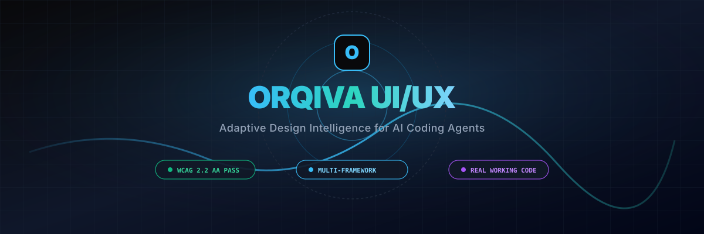
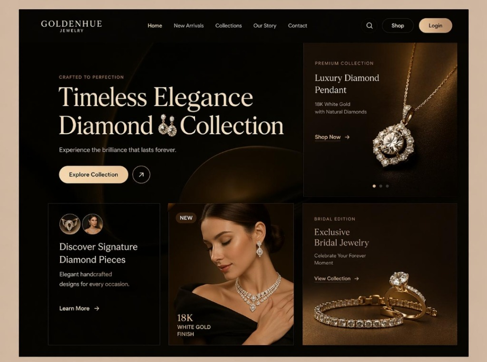
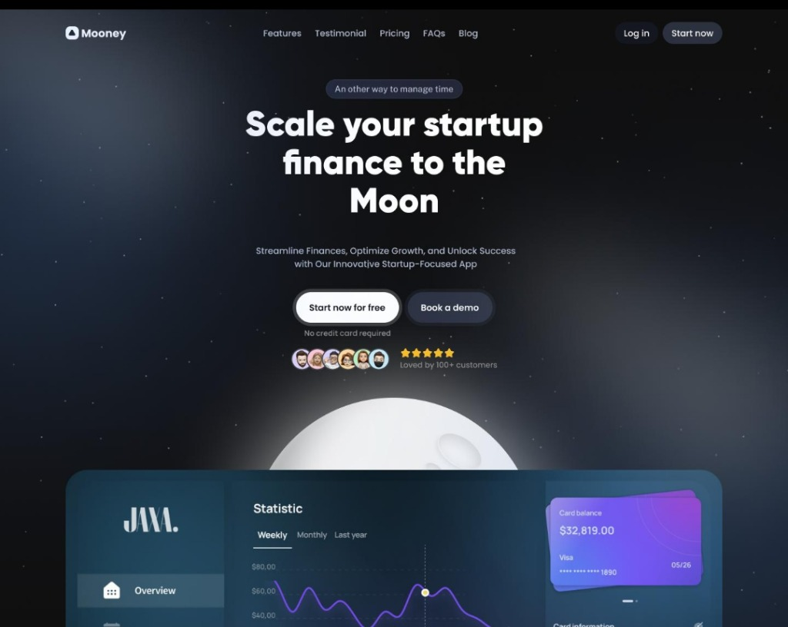
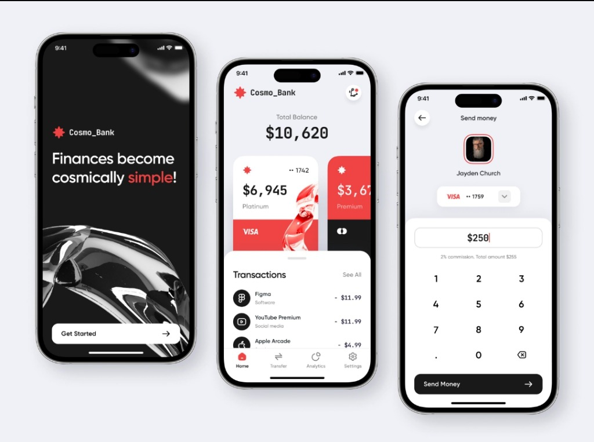
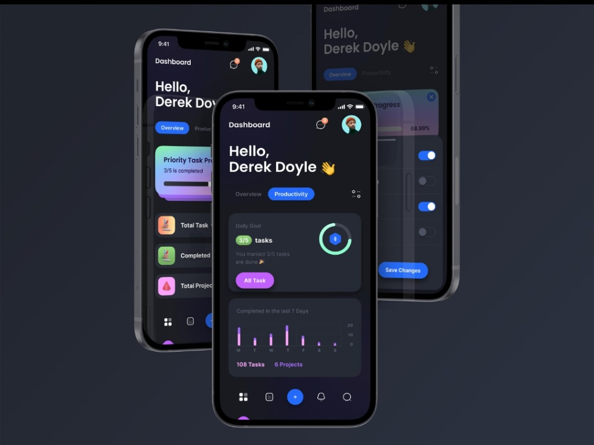
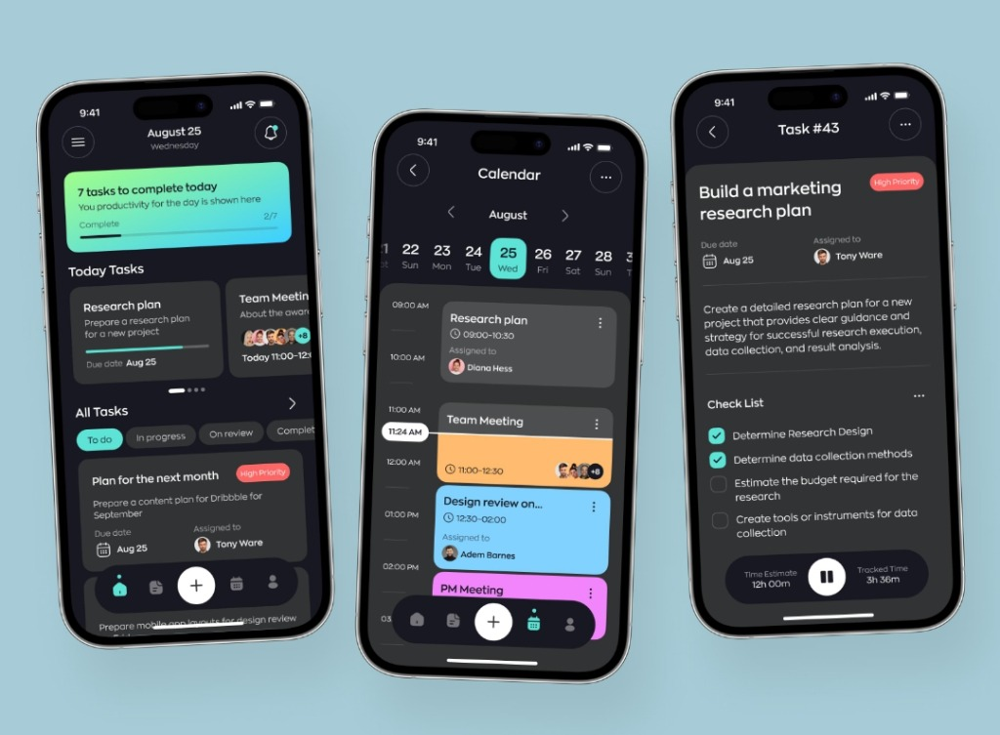
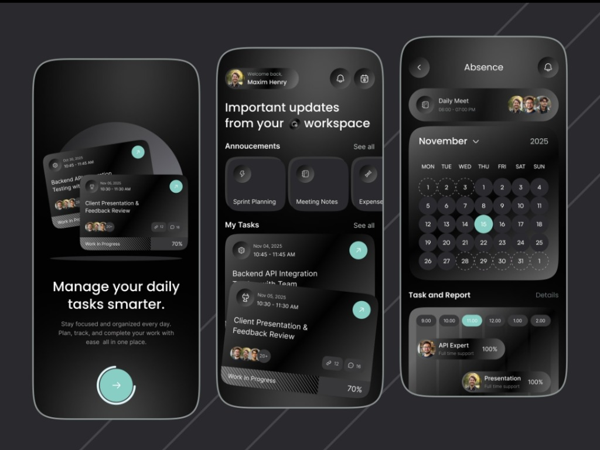
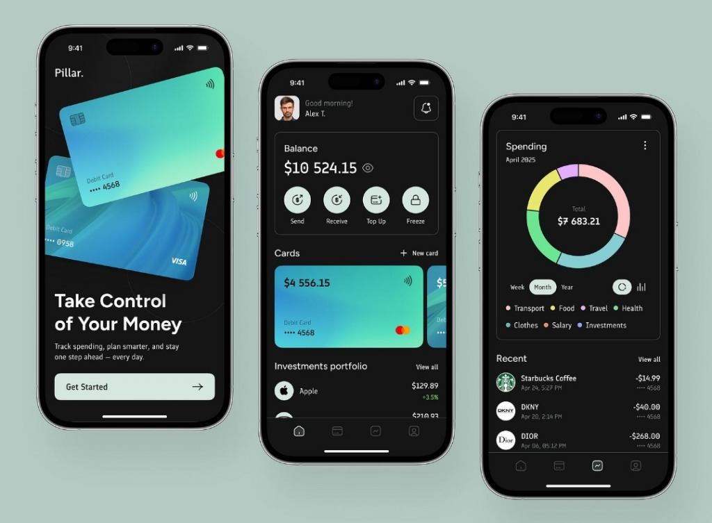

<div align="center">
  
</div>

# ORQIVA UI/UX : Adaptive Design Intelligence

[](https://github.com/CodeByArnob/orqiva-ui-ux/actions/workflows/ci.yml)
[](https://www.npmjs.com/package/orqiva-ui-ux)
[](https://mcpservers.org/agent-skills)
[](references/accessibility.md)
[](LICENSE)

**ORQIVA UI/UX** is a production-ready **Adaptive Design Intelligence** ecosystem for AI coding agents and frontend software engineers.

Standard AI coding assistants suffer from aesthetic uniformity: they default to identical dark-slate cards, purple/violet linear gradients, frosted glass, and generic buzzwords regardless of whether the user requests a high-compliance banking workflow, a luxury fashion house, or a daily task timetable.

ORQIVA eliminates generic AI output by equipping agents with senior product design heuristics, domain-specific visual directions, zero-dependency token initializers (`npx orqiva-ui-ux init`), and non-negotiable WCAG 2.2 AA accessibility enforcement.

---

## Zero-Setup Quickstart: Interactive Initializer CLI

Generate tailored design tokens and Tailwind presets in your project in seconds:

```bash
# Launch the interactive design system wizard
npx orqiva-ui-ux init

# Or run non-interactively with smart defaults
npx orqiva-ui-ux init --yes

# Audit your project code for accessibility and contrast violations
npx orqiva-ui-ux audit

# Install ORQIVA skill into Cursor, Claude Code, and Windsurf
npx orqiva-ui-ux install
```

---

## Real Application Showcase & Design Archetypes

Every interface shown below represents a real production archetype supported by ORQIVA. The skill understands the domain, spatial hierarchy, typography pairing, and contrast requirements for each design direction:

### 1. Luxury Editorial E-Commerce (AuraGlow Jewelry Atelier)
*High-fashion luxury commerce with deep obsidian canvas (`#0B0B0D`), champagne gold accents (`#D4AF37`), high-contrast serif typography, asymmetric split-screen hero canvas, and lens-zoom product spotlights.*

*Reference guide: [`references/specialized-archetypes.md#1-luxury-editorial-e-commerce`](references/specialized-archetypes.md)*

### 2. Cosmic FinTech SaaS Telemetry (OrbitFinance SaaS)
*Celestial dark-space telemetry portal featuring ambient radial nebulae, glassmorphic overview modules (`backdrop-blur-xl`), neon purple (`#8B5CF6`) and cyan (`#06B6D4`) sparklines, and floating multi-stop gradient cards.*

*Reference guide: [`references/specialized-archetypes.md#2-cosmic-fintech-saas`](references/specialized-archetypes.md)*

### 3. Liquid Chrome 3-Screen Neo-Banking (NovaBank Mobile)
*Three-screen continuous mobile banking experience: 3D liquid metallic onboarding splash, high-contrast dashboard with platinum and coral debit cards, and a dedicated 12-key tactile numeric keypad for fast P2P payments.*

*Reference guide: [`references/specialized-archetypes.md#3-liquid-chrome-neo-banking`](references/specialized-archetypes.md)*

### 4. Dark Pulse Personal Metrics (PulseFocus Productivity)
*Dark-mode personal productivity suite featuring a segmented mode switcher, circular SVG goal-completion ring (`3/5 tasks`), 7-day velocity bar metrics, and a floating dock navigation bar with quick-add actions.*

*Reference guide: [`references/specialized-archetypes.md#4-dark-pulse-productivity`](references/specialized-archetypes.md)*

### 5. Timetable Calendar & Execution Stopwatch (ChronoTask Mobile Suite)
*End-to-end task execution suite: daily progress banner (`2/7 complete`), horizontal date scrubber with active day pill, chronological hourly calendar with real-time cursor needle, and interactive checklist with integrated stopwatch.*

*Reference guide: [`references/specialized-archetypes.md#5-chronotask-mobile-suite`](references/specialized-archetypes.md)*

### 6. Neumorphic Dark Workspace Tasks (Synthetix Workspace)
*Enterprise workspace productivity suite featuring layered soft-elevation dark cards, team absence and vacation calendar grids, announcement modules, and an hourly resource allocation report.*

*Reference guide: [`references/specialized-archetypes.md#6-synthetix-workspace-tasks`](references/specialized-archetypes.md)*

### 7. Dual Mint Cards & Donut Spending Analytics (Veritas Wealth & Banking)
*Sophisticated wealth hub featuring dual floating mint and cyan debit cards with contactless chip graphics, quick utility action buttons, and a 6-segment spending breakdown donut chart with category legends.*

*Reference guide: [`references/specialized-archetypes.md#7-veritas-wealth-banking`](references/specialized-archetypes.md)*

---

## Agent Skills Specification Compatibility

ORQIVA conforms to the open [Agent Skills Specification](https://mcpservers.org/agent-skills). For architectural details, discovery protocols, and Awesome lists submission blurbs, see:
* [Agent Skills Specification Guide](docs/AGENT_SKILLS_SPEC.md)
* [Awesome Community Submission Templates](docs/AWESOME_COMMUNITY_SUBMISSIONS.md)
* [Machine-Readable Manifest](.agent-skills/manifest.json)

### Supported AI Coding Assistants

| Coding Agent | Integration Mode | Configuration Command |
|---|---|---|
| **Claude Code** | Global or Project Skill | `npx orqiva-ui-ux install --agent claude` |
| **Google Antigravity** | Workspace / Custom Skill | `npx orqiva-ui-ux install --agent antigravity` |
| **Cursor** | Cursor Rules (.mdc) | `npx orqiva-ui-ux install --agent cursor` |
| **Windsurf** | Workspace Rules | `npx orqiva-ui-ux install --agent windsurf` |
| **Roo Code / Cline** | Custom Prompt Profiles | Included in `SKILL.md` |
| **Gemini CLI** | CLI Skill Definition | Direct import |

---

## Usage Examples

Once installed, your AI coding agent automatically discovers ORQIVA when handling UI, styling, or architecture prompts:

### Luxury E-Commerce Atelier
> "Use ORQIVA to design an asymmetric editorial product page for a high-jewelry collection. Apply the AuraGlow dark obsidian and champagne gold palette with Cormorant Garamond serif headers."

### Neo-Banking Mobile Flow
> "Implement a 3-screen mobile banking flow using ORQIVA's NovaBank archetype. Include a liquid chrome splash, dual card balance overview, and a 12-key tactile transfer keypad with WCAG 2.2 AA contrast."

### SaaS Observability Console
> "Design a cosmic telemetry dashboard following ORQIVA's OrbitFinance direction. Include real-time neon sparklines, glassmorphic metric cards, and tabular monospace readouts."

---

## Project Architecture & Directory Layout

```
orqiva-ui-ux/
├── SKILL.md                 # Agent Skill entrypoint with progressive loader
├── .agent-skills/           # Machine-readable discovery manifest
│   └── manifest.json
├── bin/                     # Interactive CLI tool (zero external dependencies)
│   └── orqiva.js
├── references/              # Modular design manuals
│   ├── specialized-archetypes.md # 7 premier UI archetypes & design tokens
│   ├── design-directions.md # Visual style taxonomy (Trust-Led, Calm, Utilitarian, etc.)
│   ├── ux-architecture.md   # Information architecture, hierarchy, density tiers
│   ├── visual-foundations.md# 4pt/8pt spatial scale, typographic rhythm, semantic tokens
│   ├── design-systems-and-implementation.md # Multi-framework token translation
│   ├── responsive-design.md # Breakpoints, table-to-card reflow, thumb zones
│   ├── accessibility.md     # WCAG 2.2 AA, contrast formulas, focus traps
│   ├── interaction-patterns.md # Form validation, micro-interactions, modals vs sheets
│   ├── mobile-platforms.md  # iOS HIG vs Android M3, Jetpack Compose, Flutter
│   ├── web-applications.md  # SaaS consoles, telemetry cards, data grids
│   ├── websites-and-landing-pages.md # Conversion architecture, Core Web Vitals
│   └── quality-audit.md     # 5-dimension heuristic inspection protocol
├── workflows/               # Procedural task guides
│   ├── new-application.md   # Ground-up application development
│   ├── new-website.md       # High-converting landing page creation
│   ├── redesign-existing-ui.md # Legacy UI modernization & refactoring
│   ├── reference-to-implementation.md # Screenshot-to-code implementation
│   └── design-review.md     # Pre-release heuristic quality review
├── checklists/              # Pre-release verification gates
│   ├── accessibility.md     # WCAG 2.2 AA audit checklist
│   ├── mobile-ui.md         # Touch target and safe-area checklist
│   ├── responsive.md        # Responsive reflow and overflow checklist
│   ├── website.md           # Marketing landing checklist
│   └── design-system.md     # Component library and token checklist
├── examples/                # Multi-framework token packages
│   ├── tokens.json          # Single source of truth design tokens
│   ├── design-tokens.css    # CSS custom properties
│   ├── design-tokens.tailwind.js # Tailwind CSS configuration integration
│   ├── tokens.ts            # TypeScript typed tokens
│   ├── DesignTokens.kt      # Jetpack Compose Kotlin objects
│   └── app_theme.dart       # Flutter Theme extensions
├── assets/showcase/         # High-resolution showcase assets for the 7 archetypes
├── site/                    # Full React + Vite + Tailwind documentation & demo app
└── scripts/                 # Validation, token compiler, and packaging scripts
```

---

## Quality Assurance & Verification

ORQIVA includes automated test and validation suites:

```bash
# Validate skill manifest, links, and verify zero em-dash violations
npm run validate

# Compile multi-framework tokens (CSS, Tailwind, TypeScript, Kotlin, Dart)
npm run tokens:compile

# Build documentation website
npm run build:site

# Package release archives with SHA-256 checksums
npm run package
```

---

## Contributing

We welcome community contributions, additional platform token translators, and specialized domain directions. Please review [CONTRIBUTING.md](CONTRIBUTING.md) and our [CODE_OF_CONDUCT.md](CODE_OF_CONDUCT.md) prior to opening a pull request.

---

## Security

Security vulnerabilities should be reported following the procedure outlined in [SECURITY.md](SECURITY.md).

---

## License

ORQIVA UI/UX is open-source software licensed under the [MIT License](LICENSE).
