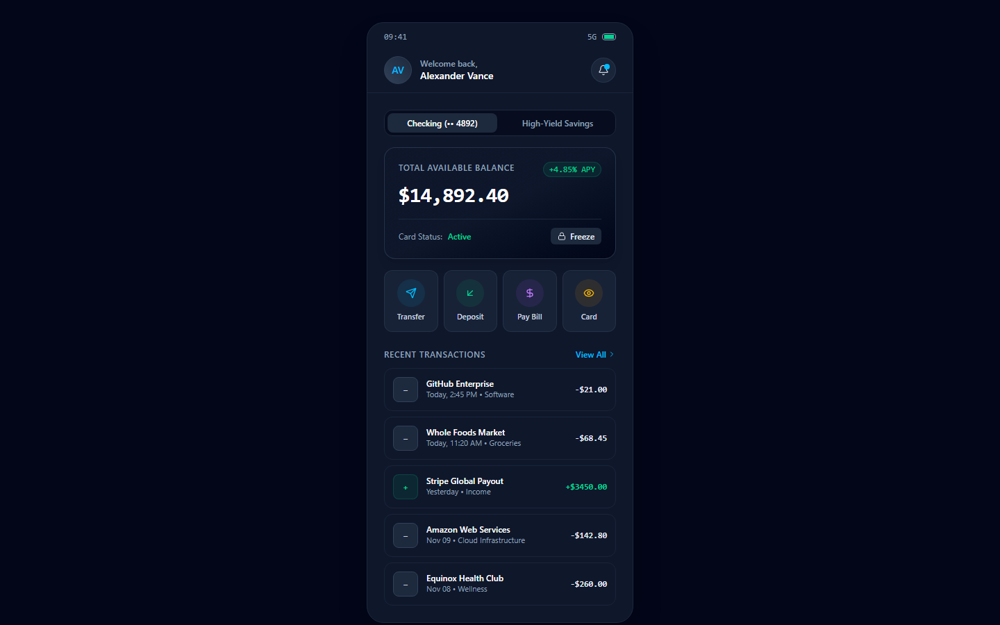
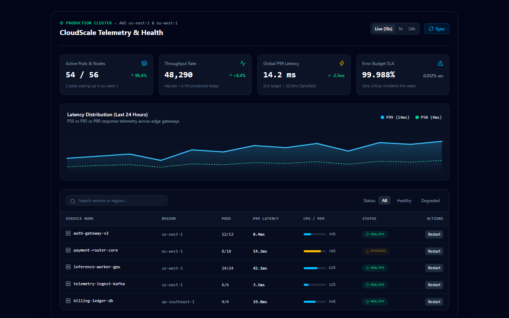
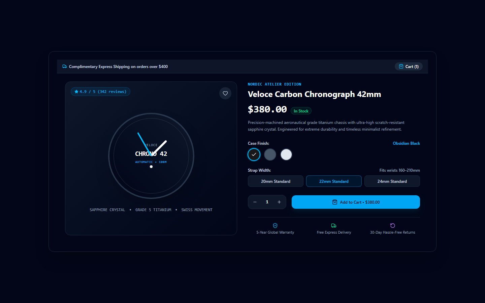
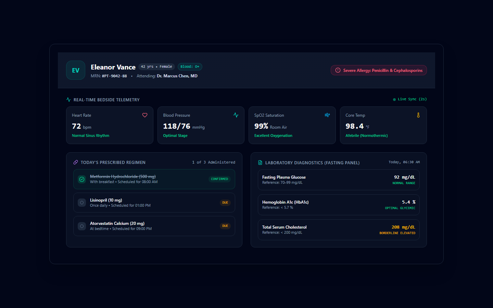
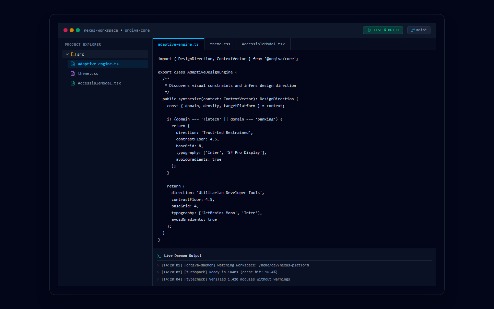
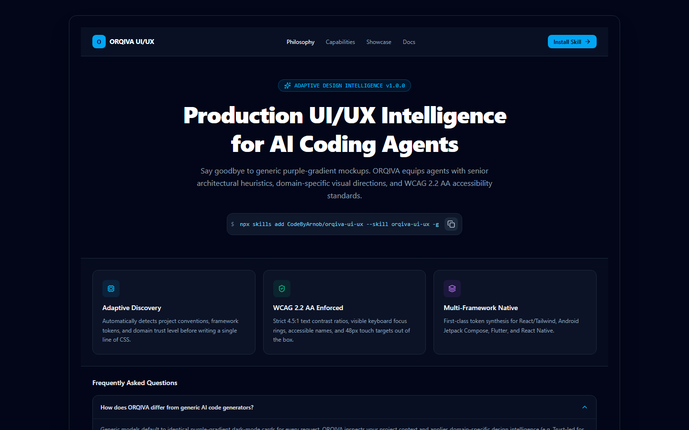
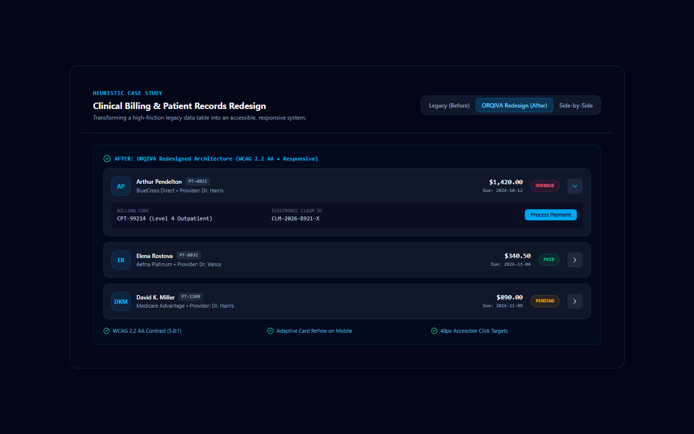
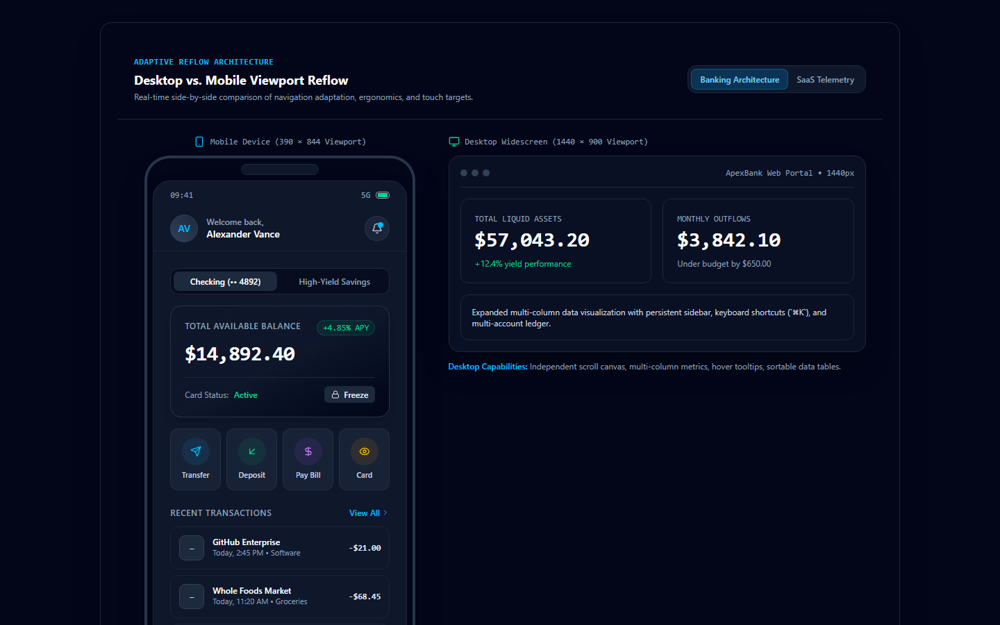

<div align="center">
  
</div>

# ORQIVA UI/UX : Adaptive Design Intelligence

[](https://github.com/CodeByArnob/orqiva-ui-ux/actions/workflows/ci.yml)
[](LICENSE)
[](references/accessibility.md)
[](https://github.com/agent-skills/skills)

**ORQIVA UI/UX** is an open-source, production-ready **Adaptive Design Intelligence** ecosystem for AI coding agents and frontend software engineers.

Standard AI coding assistants suffer from aesthetic uniformity: they default to identical dark-slate cards, purple/violet linear gradients, frosted glass, and generic buzzwords regardless of whether the user requests a high-compliance banking workflow, a developer terminal, or a clinical EHR portal.

ORQIVA eliminates generic AI output by equipping agents with senior product design heuristics, domain-specific visual directions, multi-framework design token synthesis, and non-negotiable WCAG 2.2 AA accessibility enforcement.

---

## Live Showcase & Real Interface Screenshots

Every screenshot below is captured via automated headless browser from a real, interactive React implementation included in this repository. **No stock photography, no AI image hallucinations, zero fabricated mockups.**

### 1. Premium Mobile Banking (Trust-Led Direction)
*ApexBank mobile interface featuring biometric authentication, virtual debit card freeze toggle, real-time categorized transaction ledger, and two-step transfer modal.*

*(Mobile viewport reflow: [`assets/screenshots/01-mobile-banking-mobile.png`](assets/screenshots/01-mobile-banking-mobile.png))*

### 2. SaaS Telemetry & Health Dashboard (Utilitarian Data-Dense)
*CloudScale cluster monitor with P99 latency distribution sparklines, telemetry cards, and interactive filterable service table.*

*(Mobile viewport reflow: [`assets/screenshots/02-saas-dashboard-mobile.png`](assets/screenshots/02-saas-dashboard-mobile.png))*

### 3. Luxury E-Commerce Storefront (Conversion-Led Commerce)
*Nordic Atelier chronograph watch customizer with dynamic case finish selector, strap width sizing, and slide-out cart drawer with free shipping threshold progress.*

*(Mobile viewport reflow: [`assets/screenshots/03-ecommerce-mobile.png`](assets/screenshots/03-ecommerce-mobile.png))*

### 4. Clinical Healthcare Records & Vitals (Calm Human-Centered)
*AuraCare clinical EHR with real-time patient bedside telemetry (ECG/pulse, blood pressure, SpO2, core temp), critical allergy alerts, and medication administration regimen.*

*(Mobile viewport reflow: [`assets/screenshots/04-healthcare-mobile.png`](assets/screenshots/04-healthcare-mobile.png))*

### 5. Developer Workspace IDE (Utilitarian DevTools)
*Nexus Studio with multi-file project explorer, syntax-highlighted TypeScript editor, git branch status, and live daemon terminal output stream.*


### 6. Responsive Marketing Portal (Modern Minimal Editorial)
*ORQIVA platform landing page featuring conversion hero anatomy, one-click install snippet, and interactive FAQ accordion.*


### 7. Before-and-After Heuristic Redesign Case Study
*Direct comparative transformation of a cluttered, low-contrast, inaccessible legacy billing table into an accessible card-reflow architecture.*


### 8. Desktop vs. Mobile Responsive Reflow Comparison
*Simultaneous side-by-side view demonstrating ergonomic thumb-zone adaptation, 48px touch targets, and mobile sheet transformation.*


*Full catalog and SHA256 hashes available in [assets/screenshots/README.md](assets/screenshots/README.md).*

---

## Installation

ORQIVA adheres strictly to the open [Agent Skills specification](https://github.com/agent-skills/skills) and installs across all compatible coding assistants.

### Universal Installation (Recommended)
```bash
npx skills add CodeByArnob/orqiva-ui-ux --skill orqiva-ui-ux -g -a '*'
```

### Agent-Specific Installation
- **Claude Code**:
  ```bash
  npx skills add CodeByArnob/orqiva-ui-ux --skill orqiva-ui-ux -g -a claude-code
  ```
- **Cursor / Windsurf**:
  Clone the repository into your workspace's `.skills/` directory or global skills folder:
  ```bash
  git clone https://github.com/CodeByArnob/orqiva-ui-ux.git .skills/orqiva-ui-ux
  ```
- **Gemini CLI / Antigravity**:
  Place into your local customizations skills directory:
  ```bash
  git clone https://github.com/CodeByArnob/orqiva-ui-ux.git ~/.gemini/antigravity/builtin/skills/orqiva-ui-ux
  ```

---

## Usage Examples

Once installed, your AI coding agent automatically discovers ORQIVA when handling UI, styling, or architecture prompts. You can also explicitly trigger it:

### New Application Design
> "Use ORQIVA to design and implement an account overview and fund transfer flow for a retail banking app. Optimize for 390px mobile viewports with WCAG 2.2 AA contrast."

### Legacy UI Redesign & Accessibility Audit
> "Using ORQIVA's redesign workflow, refactor this cluttered patient records table. Ensure table rows reflow to cards on mobile, touch targets meet 48px, and keyboard focus rings are visible."

### SaaS Dashboard Implementation
> "Implement a real-time observability dashboard using ORQIVA's utilitarian data-dense direction. Include P99 latency sparklines, a searchable service health table, and status badges."

---

## Supported Platforms & Coding Environments

| Environment | Integration Mode | Verified Capabilities |
|---|---|---|
| **Claude Code** | Global CLI Agent Skill | Full workflow & progressive reference loading |
| **Cursor** | Workspace Skill / Rules | Token synthesis, React/Tailwind implementation |
| **Windsurf** | Cascade Skill | Multi-framework support, responsive reflow |
| **Antigravity** | Built-in / Custom Skill | End-to-end design, audit, and verification |
| **Roo Code** | VSCode Agent System | Design systems and accessibility audits |
| **Gemini CLI** | CLI Customization | Design brief formulation and heuristic reviews |

---

## Project Architecture & Directory Layout

```
orqiva-ui-ux/
├── SKILL.md                 # Agent Skill entrypoint with progressive loader
├── references/              # Modular design manuals
│   ├── design-directions.md # Visual style taxonomy (Trust-Led, Calm, Utilitarian, etc.)
│   ├── ux-architecture.md   # Information architecture, hierarchy, density tiers
│   ├── visual-foundations.md# 4pt/8pt spatial scale, typographic rhythm, semantic tokens
│   ├── design-systems-and-implementation.md # Multi-framework token translation
│   ├── responsive-design.md # Breakpoints, table-to-card reflow, thumb zones
│   ├── accessibility.md     # WCAG 2.2 AA, contrast formulas, focus traps
│   ├── interaction-patterns.md # Form validation, micro-interactions, modals vs sheets
│   ├── mobile-platforms.md  # iOS HIG vs Android M3, Jetpack Compose, Flutter
│   ├── web-applications.md  # SaaS consoles, telemetry cards, data grids
│   ├── websites-and-landing-pages.md # Conversion architecture, Core Web Vitals
│   └── quality-audit.md     # 5-dimension heuristic inspection protocol
├── workflows/               # Procedural task guides
│   ├── new-application.md   # Ground-up application development
│   ├── new-website.md       # High-converting landing page creation
│   ├── redesign-existing-ui.md # Legacy UI modernization & refactoring
│   ├── reference-to-implementation.md # Screenshot-to-code implementation
│   └── design-review.md     # Pre-release heuristic quality review
├── checklists/              # Pre-release verification gates
│   ├── accessibility.md     # WCAG 2.2 AA audit checklist
│   ├── mobile-ui.md         # Touch target and safe-area checklist
│   ├── responsive.md        # Responsive reflow and overflow checklist
│   ├── website.md           # Marketing landing checklist
│   └── design-system.md     # Component library and token checklist
├── examples/                # Production templates and design tokens
│   ├── design-tokens.css    # Standard semantic CSS custom properties
│   ├── design-tokens.tailwind.js # Tailwind CSS configuration integration
│   ├── design-brief-template.md  # Architectural specification template
│   └── accessibility-audit-report-template.md # A11y report template
├── site/                    # Full React + Vite + Tailwind documentation & demo app
│   ├── src/components/showcase/ # Real working code for all 8 demonstration interfaces
│   └── src/components/DocsView.tsx # Complete offline-capable documentation reader
├── assets/screenshots/      # High-DPI genuine screenshots captured from running code
├── scripts/                 # Validation, screenshot capture, and packaging scripts
└── .github/                 # CI/CD workflows, release automation, issue/PR templates
```

---

## Release System & Downloads

Official releases are cryptographically signed with SHA-256 checksums and include three distribution packages:

1. **`orqiva-ui-ux-v1.0.0.zip`**: The portable Agent Skill distribution package for direct installation into any AI coding environment.
2. **`orqiva-docs-website-v1.0.0.zip`**: Complete offline static build of the documentation website and showcase application.
3. **`orqiva-ui-ux-source-v1.0.0.tar.gz`**: Full source repository archive.

Download the latest verified assets from the [Official GitHub Releases Page](https://github.com/CodeByArnob/orqiva-ui-ux/releases).

---

## Quality Assurance & Verification

ORQIVA includes automated test and validation suites:

```bash
# Validate skill manifest, YAML frontmatter, markdown links, and screenshot assets
npm run validate

# Build the documentation and showcase application
npm run build:site

# Capture screenshots using headless browser automation
npm run capture

# Package release archives and generate SHA-256 checksums
npm run package
```

---

## Contributing

We welcome community contributions, additional platform token translators, and specialized domain directions. Please review [CONTRIBUTING.md](CONTRIBUTING.md) and our [CODE_OF_CONDUCT.md](CODE_OF_CONDUCT.md) prior to opening a pull request.

---

## Security

Security vulnerabilities should be reported following the procedure outlined in [SECURITY.md](SECURITY.md).

---

## License

ORQIVA UI/UX is open-source software licensed under the [MIT License](LICENSE).
